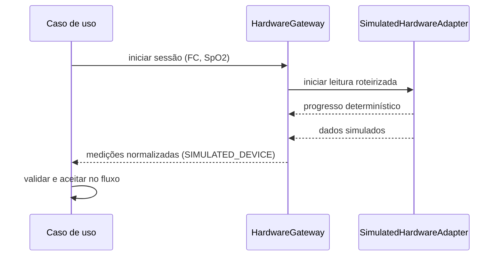
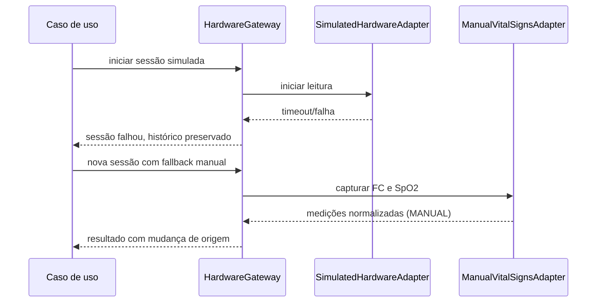
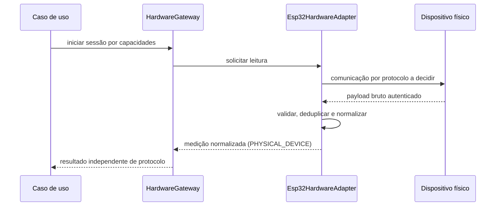

# Fronteira de integração de hardware

## Objetivo e limites

O `HardwareGateway` é a única fronteira conceitual pela qual casos de uso obtêm sinais vitais. Ele isola seleção/disponibilidade, sessões, leituras, normalização técnica e falhas. O domínio recebe somente medições normalizadas; não conhece ESP32, fabricante, firmware, Wi-Fi, Bluetooth, serial, HTTP, MQTT, payload ou biblioteca.

O gateway não classifica prioridade, não decide validade clínica, não altera a triagem diretamente e não escolhe cuidado. Casos de uso decidem aceitar/rejeitar uma medição e quando pedir análise. O motor nunca controla hardware.

```text
Casos de uso → HardwareGateway → adaptador manual | adaptador simulado | futuro adaptador ESP32
```

A dependência é sempre nesse sentido. Adaptadores implementam o contrato; não chamam casos de uso nem regras de domínio.

## Adaptadores e capacidades

- `ManualVitalSignsAdapter`: captura controlada por pessoa, origem `MANUAL`.
- `SimulatedHardwareAdapter`: simula deterministicamente conexão, progresso, sucesso, timeout, falha, leitura inválida, repetição e desconexão; origem `SIMULATED_DEVICE`.
- `Esp32HardwareAdapter`: possibilidade futura para dispositivo físico, origem `PHYSICAL_DEVICE`; inexistente na V0.

Cada adaptador declara capacidades opcionais: selecionar/identificar dispositivo, consultar disponibilidade/estado, iniciar/finalizar sessão, iniciar/repetir/cancelar leitura e publicar progresso/medição/falha. Dispositivos podem medir combinações distintas. A V0 usa FC e SpO₂; temperatura, pressão e outros tipos são futuros.

## Contrato conceitual

O gateway oferece operações equivalentes a:

1. listar/selecionar ou identificar fonte, quando suportado;
2. consultar capacidades, disponibilidade e estado;
3. iniciar `HardwareCollectionSession` com medições esperadas;
4. iniciar leitura e receber progresso, medição ou falha;
5. repetir ou cancelar uma leitura;
6. finalizar sessão preservando resultado e tentativas.

Operações assíncronas devem admitir timeout, cancelamento, erro discriminado e correlação. O contrato não prescreve TypeScript, transporte ou protocolo.

## Dispositivo e sessão

`MedicalDevice` contém identificadores interno/externo, tipo, nome, fabricante/modelo/firmware quando disponíveis, capacidades, estado, última comunicação, adaptador e ativo/inativo. Não armazena dados pessoais desnecessários. V0 pode ter dispositivos fictícios, sem cadastro, provisionamento ou gestão completa.

`HardwareCollectionSession` representa uma tentativa controlada: identificador, triagem/coleção, adaptador/dispositivo, origem, medições esperadas/recebidas, início/fim, estado, erros, número de tentativa, ator, auditoria e metadados técnicos mínimos. Repetição e fallback criam novo histórico; nunca sobrescrevem sessão anterior.

## Máquinas de estado separadas

Estados conceituais do dispositivo: `UNKNOWN`, `UNAVAILABLE`, `AVAILABLE`, `CONNECTING`, `CONNECTED`, `PREPARING`, `COLLECTING`, `READING_COMPLETED`, `ERROR`, `DISCONNECTED`.

Estados conceituais da sessão/coleta: `PENDING`, `AWAITING_DEVICE`, `READY`, `IN_PROGRESS`, `COMPLETED`, `FAILED`, `CANCELLED`, `EXPIRED`, `RECOLLECTION_REQUIRED`.

Esses estados não são estados da triagem. Somente o resultado do caso de uso — medição aceita, necessidade de repetir ou indisponibilidade — provoca transição na máquina de triagem.

## Dados brutos, normalização e aceite

1. **Dado bruto:** payload, valor não normalizado, código do sensor, sequência e qualidade declarada. Fica na infraestrutura; retenção é opcional e pendente.
2. **`DeviceMeasurement`:** medição recebida e normalizada tecnicamente com tipo, valor, unidade, horário do dispositivo, recebimento do servidor, horário normalizado, origem, sessão, dispositivo, estado, qualidade, observação, versão do adaptador e referência permitida ao bruto.
3. **`VitalSignMeasurement`:** medição normalizada que o caso de uso aceitou para a triagem e que pode chegar ao motor.

Estados da medição distinguem `RECEIVED`, `TECHNICALLY_VALIDATED`, `ACCEPTED`, `REJECTED` e `SUPERSEDED_BY_RECOLLECTION`. Substituída não significa apagada. Critérios clínicos de validade permanecem indefinidos.

Origens são `MANUAL`, `SIMULATED_DEVICE` e `PHYSICAL_DEVICE`. Origem é sempre persistida/exibida; simulação jamais aparece como física.

No Marco 3, `HardwareCollectionSession`, `VitalSignMeasurement` e `HardwareError` persistem somente estrutura e histórico. O seed demonstra sessão simulada, falha e fallback manual. Não existe `HardwareGateway`, adaptador ou comunicação executável; payload bruto não integra o schema.

No Marco 6, o `HardwareGateway` passa a ter contrato executável mínimo (`startCollection`, `getResult`, `cancelCollection`) e adapters manual/simulado. Cada tentativa cria sessão; falha/timeout/invalidade persistem erro seguro e permitem nova tentativa ou fallback manual. Somente FC e SpO₂ aceitas da sessão concluída mais recente seguem à reanálise. Continua inexistindo ESP32, protocolo ou dispositivo físico.

## Falhas, timeout e fallback

Tratar explicitamente: indisponibilidade; falha/conexão perdida; timeout; leitura incompleta; valor/unidade inválidos; duplicidade; fora de ordem; dispositivo não autorizado; falha parcial; cancelamento e expiração. Erros são estruturados, seguros e auditáveis.

Retry é limitado e controlado pelo caso de uso, não infinito no adaptador. Nova tentativa cria sessão/histórico novo. Na V0, fallback manual cria sessão `MANUAL` e registra a troca de origem. Falha nunca apaga triagem nem bloqueia permanentemente revisão humana.

## Idempotência e tempo

Integrações reais podem reenviar mensagens. O projeto futuro precisa de identificador de sessão e medição, sequência/chave equivalente, deduplicação e processamento idempotente, preservando tentativas legítimas diferentes.

Timestamp do dispositivo não é confiado cegamente. Registrar separadamente horário informado pelo dispositivo, recebimento no servidor e horário normalizado usado pelo sistema. Política de sincronização fica pendente antes de integração real.

## Segurança e observabilidade

Antes de dispositivo real: identidade única, autenticação, autorização por unidade, credenciais rotacionáveis/revogáveis, proteção contra dispositivo não autorizado/replay/adulteração, validação e limites de payload/frequência, minimização e ausência de segredo fixo no repositório. Origem física não torna valor confiável; validação técnica continua obrigatória.

Métricas/eventos futuros: disponibilidade, conexão iniciada/concluída, sessão/leitura iniciada/concluída/rejeitada, timeout, falha, duração, tentativas e taxa de sucesso por adaptador. Logs não contêm nome, documento, anamnese ou payload clínico identificável.

## Sequências conceituais

### Simulação bem-sucedida



### Falha e fallback manual



### Futuro adaptador ESP32



## Decisões pendentes para ESP32

Topologia; descoberta; autenticação e pareamento; protocolo (HTTP, WebSocket, MQTT, backend intermediário ou outro); formato/versionamento de mensagens; desconexão; retry/idempotência; sincronização; firmware; segurança de rede; offline; retenção de payload bruto; calibração/qualidade; operação e suporte. Qualquer escolha de protocolo exige ADR antes de implementação.
