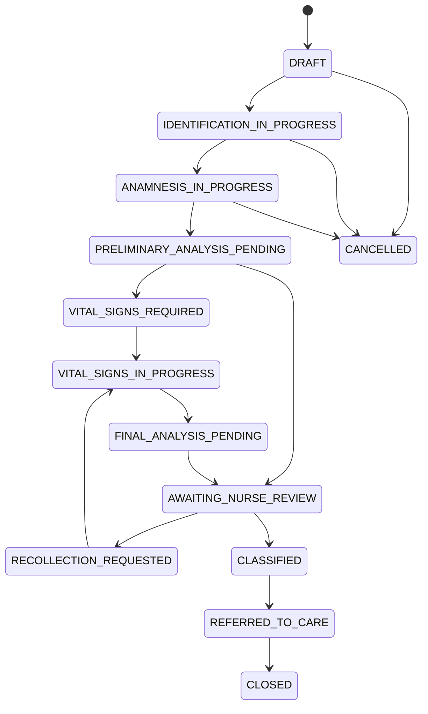

# Máquina de estados da triagem

Estados são exclusivos; ausência de estado ou flags contraditórias é inválida. Atores: **paciente**, **sistema**, **enfermagem** e **operação demo**. Toda transição grava `AuditEvent` na mesma mudança crítica. Estados de dispositivo e de `HardwareCollectionSession` são máquinas separadas e nunca substituem o estado da triagem.

## Transições normais

| Origem → destino | Ator | Pré-condições | Efeitos e auditoria |
|---|---|---|---|
| criação → `DRAFT` | paciente/sistema | contexto demo disponível | cria triagem; `TRIAGE_STARTED` |
| `DRAFT` → `IDENTIFICATION_IN_PROGRESS` | paciente | triagem ativa | abre identificação; `STEP_STARTED` |
| `IDENTIFICATION_IN_PROGRESS` → `ANAMNESIS_IN_PROGRESS` | paciente | identificação mínima, plano coerente e consentimento vigente aceito | persiste dados e consentimento; `CONSENT_ACCEPTED`, `IDENTIFICATION_COMPLETED` |
| `ANAMNESIS_IN_PROGRESS` → `PRELIMINARY_ANALYSIS_PENDING` | paciente | respostas obrigatórias válidas | fecha versão da anamnese; `ANAMNESIS_SUBMITTED` |
| análise pendente → `VITAL_SIGNS_REQUIRED` | sistema | execução bem-sucedida solicita coleta | anexa análise/recomendação; `ANALYSIS_RUN`, `RECOMMENDATION_CREATED` |
| análise pendente → `AWAITING_NURSE_REVIEW` | sistema | execução bem-sucedida dispensa coleta, ou falha encaminhada para humano | anexa resultado/falha, gera senha se ausente; eventos de análise, senha e fila |
| `VITAL_SIGNS_REQUIRED` → `VITAL_SIGNS_IN_PROGRESS` | paciente/enfermagem | solicitação ativa | inicia coleção; `VITAL_COLLECTION_STARTED` |
| `VITAL_SIGNS_IN_PROGRESS` → `FINAL_ANALYSIS_PENDING` | paciente/sistema | FC e SpO₂ válidas ou tentativa encerrada com política de recuperação | fecha coleção sem apagar tentativas; `VITALS_RECORDED`/`VITALS_FAILED` |
| `FINAL_ANALYSIS_PENDING` → `AWAITING_NURSE_REVIEW` | sistema | análise criada ou falha registrada | anexa nova análise, gera senha se necessário; eventos correspondentes |
| `AWAITING_NURSE_REVIEW` → `CLASSIFIED` | enfermagem | evidências revisadas; confirmação ou reclassificação justificada | cria decisão humana; `CLASSIFICATION_CONFIRMED` ou `RECLASSIFIED` |
| `AWAITING_NURSE_REVIEW` → `RECOLLECTION_REQUESTED` | enfermagem | motivo registrado | cria pedido; `RECOLLECTION_REQUESTED` |
| `RECOLLECTION_REQUESTED` → `VITAL_SIGNS_IN_PROGRESS` | paciente/enfermagem | pedido ativo | nova coleção; `VITAL_COLLECTION_STARTED` |
| `CLASSIFIED` → `REFERRED_TO_CARE` | enfermagem | classificação humana vigente | cria encaminhamento; `REFERRED_TO_CARE` |
| `REFERRED_TO_CARE` → `CLOSED` | enfermagem | encaminhamento existente; desfecho simples opcional | encerra; `TRIAGE_CLOSED` |
| estados de coleta inicial → `CANCELLED` | paciente/enfermagem | motivo e política permitirem | preserva dados; `TRIAGE_CANCELLED` |

## Falhas e recuperação

- Entrada inválida mantém o estado e registra erro operacional sem conteúdo sensível; usuário corrige e reenvia.
- Falha do motor mantém a tentativa de `AnalysisRun`, permite repetição controlada ou segue para revisão pendente marcada “análise indisponível”; nunca fabrica prioridade.
- Falha/indisponibilidade de leitura fica na coleção; repetir cria nova medição/tentativa.
- Concorrência ou transição inválida é rejeitada sem efeito parcial e pode ser recarregada.
- Retomada volta ao último estado persistido; expiração/cancelamento futuro exige decisão de produto.
- Reabrir `CLOSED`/`CANCELLED`, voltar após encaminhamento e classificar sem revisão são proibidos na V0.

## Relação com sessões de hardware

`VITAL_SIGNS_REQUIRED` autoriza criar uma sessão; não significa que um dispositivo esteja disponível. O caso de uso move para `VITAL_SIGNS_IN_PROGRESS` e acompanha a sessão fora desta máquina. Sessão concluída com medições normalizadas aceitas permite `FINAL_ANALYSIS_PENDING`. Falha, timeout ou cancelamento mantém histórico e permite nova sessão ou fallback manual. Se nenhuma medição utilizável puder ser obtida, a revisão humana continua disponível com indisponibilidade explícita; detalhes como conectar/desconectar não viram estados da triagem.

## Implementação pura

O Marco 3 implementa a tabela de transições em `src/domain/triage`, sem dependência de Prisma. `CLOSED` e `CANCELLED` são terminais; cancelamento explícito está permitido nos três estados iniciais documentados; encaminhamento só parte de `CLASSIFIED`; nova coleta parte de `AWAITING_NURSE_REVIEW` e retorna por `RECOLLECTION_REQUESTED` a `VITAL_SIGNS_IN_PROGRESS`.

No Marco 5, a análise preliminar transacional consome somente `PRELIMINARY_ANALYSIS_PENDING`: quando as regras demo solicitam coleta, avança para `VITAL_SIGNS_REQUIRED`; caso contrário, avança para `AWAITING_NURSE_REVIEW`. A ação idempotente pode consultar a execução já concluída depois da mudança de estado, mas não cria nova transição nem alcança `CLASSIFIED`.

No Marco 6, a primeira tentativa avança para `VITAL_SIGNS_IN_PROGRESS`; falhas mantêm esse estado. A confirmação percorre `FINAL_ANALYSIS_PENDING` e termina em `AWAITING_NURSE_REVIEW`, preservando sessões anteriores.

No Marco 7, emitir ou recuperar `QueueTicket` é efeito idempotente dentro de `AWAITING_NURSE_REVIEW`, não uma transição. A triagem permanece aguardando enfermagem; nenhuma emissão alcança `CLASSIFIED` ou cria revisão humana.

No Marco 9, confirmação/reclassificação criam `NurseReview` e percorrem `AWAITING_NURSE_REVIEW → CLASSIFIED`; encaminhamento exige essa decisão e percorre `CLASSIFIED → REFERRED_TO_CARE`. Nova coleta só parte de `AWAITING_NURSE_REVIEW`, percorre `RECOLLECTION_REQUESTED → VITAL_SIGNS_IN_PROGRESS → FINAL_ANALYSIS_PENDING → AWAITING_NURSE_REVIEW` e anexa sessão/análise. Nenhuma ação alcança `CLOSED`.

No Marco 10, toda entrada em `AWAITING_NURSE_REVIEW` coordena senha e auditoria atomicamente. A análise final permanece cálculo puro; a execução contextual usa sessão/tentativa para distinguir uma recoleta legítima de reenvio duplicado.
