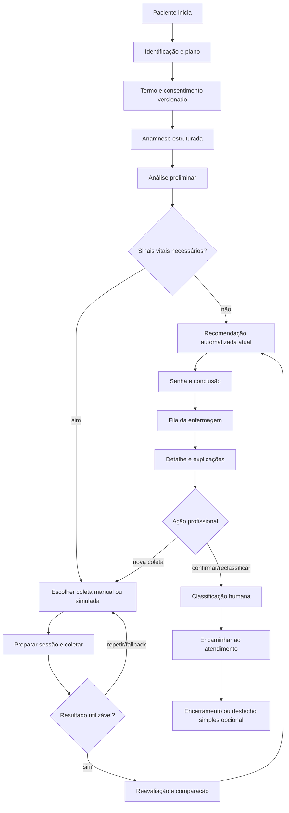

# Fluxos de usuário

## Jornada integrada

## Paciente

1. Inicia uma triagem e recebe registro auditável.
2. Informa nome, nascimento/idade, sexo quando pertinente, identificador demonstrativo, existência e nome de plano quando aplicável.
3. Lê e aceita termo vigente; sistema registra versão e instante. Sem aceite, não avança e permite cancelar.
4. Responde queixa, complemento, intensidade, início/duração, alertas, histórico, condições, medicamentos, alergias e observação opcional. Perguntas vêm de definição central do domínio.
5. Aguarda análise preliminar. Falha do motor cria estado recuperável e encaminhamento para revisão humana, não uma classificação inventada.
6. Se solicitado, escolhe entrada manual ou dispositivo simulado, sempre pelo `HardwareGateway`. O fluxo prepara a sessão, mostra progresso e recebe uma medição normalizada. Em falha, timeout, leitura inválida ou desconexão, pode repetir ou usar fallback manual; a mudança de origem e todas as tentativas permanecem. Somente medição aceita segue à análise.
7. Ao alcançar `AWAITING_NURSE_REVIEW`, recebe ou recupera a mesma senha operacional, vê o resumo das etapas e o aviso de que a prioridade final ainda não foi confirmada.
8. Pode iniciar nova demonstração; o sistema cria outra triagem e troca o cookie opaco sem apagar a anterior.

### Fluxo funcional disponível no Marco 4

`/paciente` inicia ou retoma uma triagem demonstrativa por cookie `httpOnly` com ID opaco. Identificação cria o paciente e plano fictícios; consentimento persiste versão/aceite e avança para anamnese; anamnese persiste campos e respostas versionadas e termina em `PRELIMINARY_ANALYSIS_PENDING`. Cada mudança crítica ocorre em transação e gera apenas os cinco eventos previstos, sem respostas nos metadados.

### Conclusão funcional disponível no Marco 7

Triagens com análise preliminar suficiente ou reanálise pós-sinais vitais terminam em `AWAITING_NURSE_REVIEW`. A tela final emite ou recupera, de forma transacional e idempotente, uma senha `T-AAAAMMDD-NNN`, mostra somente resumo seguro e permite iniciar outra demonstração. Isso não conecta o painel da enfermagem nem cria classificação humana.

## Motor e explicabilidade

Cada execução guarda entradas referenciáveis, conjunto de regras, momento, tipo preliminar/pós-medição, saída e razões. A reavaliação cria novo registro e apresenta o que manteve ou alterou a recomendação. Razões apontam dado e regra identificável; “a IA decidiu” é proibido.

## Enfermagem

A fila ordena por prioridade recomendada e tempo conforme regra explícita, exibindo senha, resumo, idade, queixa, status, espera, alerta e pendência. O detalhe reúne consentimento, anamnese, histórico, alertas, medições/origens, análises, razões, regra e auditoria.

### Consulta funcional disponível no Marco 8

`/enfermagem` consulta somente triagens em `AWAITING_NURSE_REVIEW`, ordenadas por recomendação demonstrativa (`RED`, `YELLOW`, `GREEN`) e entrada mais antiga. `/enfermagem/triagens/[triageId]` apresenta dados mínimos, análises preservadas, sinais vitais, tentativas e linha do tempo sanitizada. A atualização é manual por nova renderização server-side; não há autenticação real, WebSocket, polling ou ação profissional.

### Ações funcionais disponíveis no Marco 9

No detalhe, a enfermagem confirma a recomendação ou registra prioridade diferente com justificativa. Ambas criam decisão humana separada e levam a `CLASSIFIED`. Antes de classificar, pode solicitar nova coleta; o paciente retoma sinais vitais, cria outra sessão ao coletar e retorna à revisão após nova análise. Somente uma triagem classificada pode ser encaminhada. Nenhuma dessas ações fecha a triagem.

- **Confirmar:** copia a prioridade recomendada atual para uma nova decisão humana, sem fundir os registros.
- **Reclassificar:** escolhe outra prioridade e fornece justificativa obrigatória.
- **Nova coleta:** registra solicitação, retorna ao fluxo de sinais vitais e produz nova análise, sem sobrescrita.
- **Encaminhar:** exige classificação humana válida e cria encaminhamento; fluxo principal termina aqui.

Atualização de fila pode usar polling, revalidação ou atualização manual. O encerramento opcional apenas registra alta/observação/internação/emergência como rótulo demonstrativo, sem criar módulos assistenciais.
